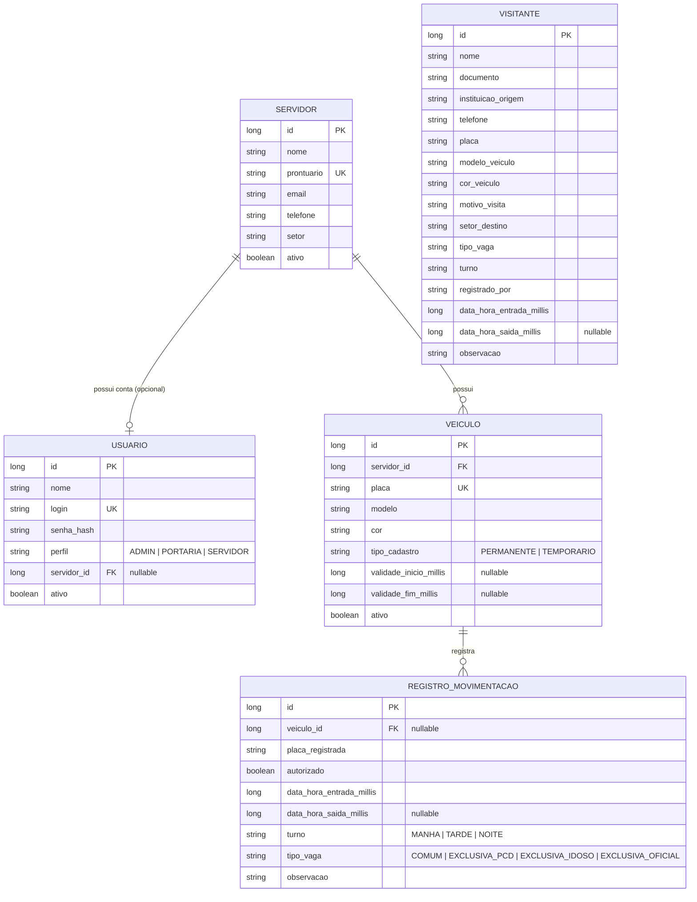
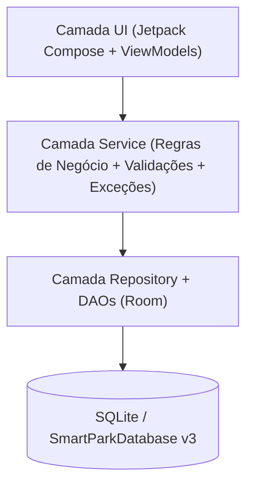
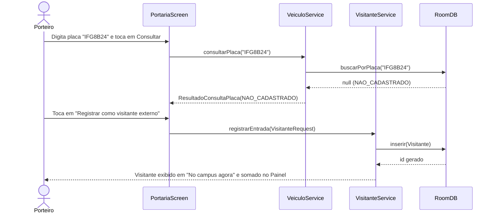

# Modelos de Análise e Design — SmartPark (Room v3)

## 1. Modelo Entidade-Relacionamento (Banco Local Room)

---

## 2. Arquitetura em Camadas por Domínio

---

## 3. Diagrama de Sequência — Consulta de Placa e Redirecionamento para Visitante

