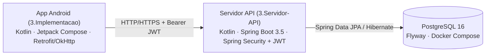

# SmartPark — Parking Solvers

Sistema de gestão e monitoramento do estacionamento para Institutos Federais (Projeto Final de Programação de Dispositivos Móveis — PDIM — BCC — 2026-2).

**Equipe:** Caio Emanuel, Lucas Nunes, Luiza Bueno e Michel Amancio  
**Cliente (Product Owner):** Prof. Fábio Santos

> **Sobre esta branch (`feat/api-spring-boot`):** migra a persistência do projeto de banco local SQLite/Room para uma **API REST centralizada em Spring Boot (Kotlin) com PostgreSQL**, containerizada com **Docker**. A branch `main` permanece preservada com a versão original em banco local Room.

---

## Visão Geral da Arquitetura



Todas as regras de negócio, autenticação, validações, cálculos de ocupação e controle de concorrência ficam centralizados na API (`3.Servidor-API/`). O aplicativo Android (`3.Implementacao/`) atua como cliente online-only consumindo os endpoints REST.

---

## Tecnologias Utilizadas, Como e Onde Foram Aplicadas

### 1. Backend / Servidor API (`3.Servidor-API/`)

| Tecnologia | Como foi utilizada | Onde está no projeto |
| :--- | :--- | :--- |
| **Kotlin 2.1 + Java 21** | Linguagem do servidor, permitindo reaproveitar o mesmo modelo de domínio, DTOs e regras de negócio do app Android. | `3.Servidor-API/src/main/kotlin/com/parkingsolvers/smartpark/` e `build.gradle.kts` |
| **Spring Boot 3.5 (Web MVC)** | Exposição dos endpoints REST (`/auth`, `/servidores`, `/usuarios`, `/veiculos`, `/movimentacoes`, `/visitantes`, `/dashboard`, `/configuracao-estacionamento`) e tratamento global de exceções (`@RestControllerAdvice`). | `**/controller/*.kt` e `compartilhado/ApiExceptionHandler.kt` |
| **Spring Data JPA + Hibernate** | Mapeamento objeto-relacional das 6 tabelas, queries derivadas e lock pessimista (`PESSIMISTIC_WRITE`) na linha de configuração para serializar entradas concorrentes em vagas elétricas. Configurado com `ddl-auto: validate`. | `**/model/*.kt`, `**/repository/*.kt` e `application.yml` |
| **PostgreSQL 16** | Banco de dados relacional centralizado, substituindo o SQLite/Room local. Datas armazenadas em `TIMESTAMPTZ` (UTC) e integridade garantida por FKs, índices e `CHECK` constraints. | `3.Servidor-API/docker-compose.yml` e `src/main/resources/db/migration/V1__schema.sql` |
| **Flyway** | Versionamento e aplicação automática das migrações SQL na inicialização do servidor. | `3.Servidor-API/src/main/resources/db/migration/V1__schema.sql` |
| **Spring Security + JJWT (JWT) + BCrypt** | Autenticação stateless com tokens JWT HS256 (`accessToken` de 60 min e `refreshToken` de 7 dias), senhas criptografadas com `BCryptPasswordEncoder`, autorização por papel (`@PreAuthorize` para `ADMIN`, `PORTARIA`, `SERVIDOR`) e bloqueio contra força bruta (`LoginAttemptService`: 5 falhas = 15 min). | `auth/security/SecurityConfig.kt`, `auth/security/JwtService.kt`, `auth/service/AuthService.kt`, `auth/service/LoginAttemptService.kt` |
| **SpringDoc OpenAPI (Swagger UI)** | Documentação interativa da API REST com suporte a autenticação `Bearer JWT` em `/swagger-ui.html` (ativa em `dev`, desativada por padrão em `prod`). | `config/OpenApiConfig.kt`, `application-prod.yml` |
| **Spring Boot Actuator** | Endpoint de monitoramento `/actuator/health` usado por Docker `HEALTHCHECK` e provedores de nuvem. | `application.yml` e `Dockerfile` |
| **JUnit 5 + Mockito + Testcontainers** | Testes unitários de regras de negócio e teste de integração ponta a ponta (`ApiIntegracaoTest`) que sobe um container `postgres:16-alpine` real, executa a migração Flyway e testa todos os endpoints. | `3.Servidor-API/src/test/kotlin/com/parkingsolvers/smartpark/` |

### 2. Infraestrutura, Containers e CI/CD (`3.Servidor-API/` e `.github/workflows/`)

| Tecnologia | Como foi utilizada | Onde está no projeto |
| :--- | :--- | :--- |
| **Docker (`Dockerfile` multi-stage)** | Compila o JAR executável em uma imagem `eclipse-temurin:21-jdk-alpine` e gera uma imagem final enxuta em `eclipse-temurin:21-jre-alpine`, rodando com usuário não-root (`smartpark`) e `HEALTHCHECK` em `/actuator/health`. | `3.Servidor-API/Dockerfile` e `3.Servidor-API/.dockerignore` |
| **Docker Compose** | Orquestra o PostgreSQL 16 em desenvolvimento local (porta `5433` para não conflitar com Postgres local na `5432`) e, opcionalmente, o conjunto completo API + Banco via `--profile full`. | `3.Servidor-API/docker-compose.yml` e `3.Servidor-API/.env.example` |
| **Perfis Spring (`dev` e `prod`)** | Em `dev`, cria automaticamente `admin` / `admin123` se o banco estiver vazio. Em `prod`, exige `DB_URL`, `DB_USER`, `DB_PASSWORD`, `JWT_SECRET` por variáveis de ambiente e permite bootstrap seguro do primeiro admin via `ADMIN_INITIAL_LOGIN` / `ADMIN_INITIAL_PASSWORD`. | `application.yml`, `application-prod.yml`, `dev/AdminInicialDev.kt`, `config/AdminInicialProd.kt` |
| **GitHub Actions (CI)** | A cada push ou Pull Request, executa os testes da API (com Testcontainers), valida o `docker build` da imagem do servidor e compila/testa o app Android. | `.github/workflows/ci.yml` |

### 3. Aplicativo Android (`3.Implementacao/`)

| Tecnologia | Como foi utilizada | Onde está no projeto |
| :--- | :--- | :--- |
| **Kotlin 2.2 + Jetpack Compose + Material 3** | Interface declarativa com navegação por perfil (`ADMIN`, `PORTARIA`, `SERVIDOR`), `ViewModel` + `StateFlow` e componentes reutilizáveis (`AppShell`, `PlacaMercosulChip`, `SmartParkCard`, `MeusDadosDialog`). | `3.Implementacao/app/src/main/java/com/parkingsolvers/smartpark/` |
| **Retrofit 2 + Gson** | Cliente HTTP tipado que mapeia todos os endpoints da API Spring Boot e serializa/desserializa os DTOs JSON (incluindo conversão de datas ISO-8601 UTC ↔ epoch millis compatível com `minSdk 24`). | `rede/SmartParkApi.kt`, `rede/ApiDtos.kt`, `rede/Iso8601.kt`, `rede/ApiErrorMapper.kt` |
| **OkHttp 4 (`AuthInterceptor` e `TokenAuthenticator`)** | Injeta automaticamente o cabeçalho `Authorization: Bearer <token>` em rotas autenticadas e renova a sessão via `POST /auth/refresh` de forma transparente ao receber `401` (voltando para o login se o refresh expirar). | `rede/ApiClient.kt` |
| **SharedPreferences (`SessaoStore`)** | Persiste `accessToken`, `refreshToken` e dados da sessão ativa para manter o usuário conectado entre aberturas do app. | `rede/SessaoStore.kt` |
| **Kotlin Coroutines + `StateFlow` (`SincronizadorDados`)** | Mantém as telas reativas após operações de escrita e pelo botão de atualizar na barra superior, sem depender mais de `Flow` do Room. | `rede/FluxoRemoto.kt`, `rede/ApiClient.kt` e `**/service/*Service.kt` |
| **Network Security Config + `BuildConfig`** | Bloqueia tráfego HTTP sem criptografia em builds `release` (HTTPS obrigatório) e permite HTTP local apenas em `debug`, com URL injetável via `-PAPI_BASE_URL=...`. | `app/src/main/res/xml/network_security_config.xml`, `app/src/debug/res/xml/network_security_config.xml`, `app/build.gradle.kts` |
| **JUnit 4 + OkHttp MockWebServer + Coroutines Test** | Testa localmente o cliente HTTP (envio de Bearer, refresh automático em 401, mapeamento de erros HTTP para exceções de domínio), conversor ISO-8601 e validadores de placa/formulário. | `3.Implementacao/app/src/test/java/com/parkingsolvers/smartpark/` |

---

## Funcionalidades Principais

- **Controle de acesso por 3 níveis (`ADMIN`, `PORTARIA` e `SERVIDOR`):** autenticação via JWT, senhas com hash BCrypt no servidor, proteção contra força bruta (5 falhas = bloqueio de 15 min) e edição do próprio perfil em **Meus dados** (`GET/PUT /usuarios/me`).
- **Cadastro de servidores e veículos permanentes/temporários:** validação de placas brasileiras padrão antigo (`AAA-1234`) e Mercosul (`ABC1D23`), exibição com o componente `PlacaMercosulChip` e controle automático de vigência temporária no servidor.
- **Portaria e visitantes externos:** consulta instantânea de autorização por placa (`GET /veiculos/placa/{placa}`), registro de entradas e saídas de servidores e ficha completa de visitantes externos.
- **Vagas para carregamento de veículos elétricos (expansível e transacional):** inicia configurada com **2 vagas de carregamento elétrico** no PostgreSQL (`configuracao_estacionamento`), com bloqueio transacional (`PESSIMISTIC_WRITE`) para evitar concorrência entre portarias e edição pela Administração.
- **Painel de ocupação:** métricas calculadas no servidor em tempo real (servidores + visitantes), vagas elétricas, vagas exclusivas (PCD, Idoso e Oficial) e média diária por turno filtrada por *Hoje*, *7 dias* ou *Tudo*.

---

## Estrutura do Repositório

Organizado segundo o processo ágil **SpinOff** e o padrão do repositório de referência (`C4103M/carToon`):

```text
.
├── .github/
│   ├── ISSUE_TEMPLATE/             # Templates de issues (feature, bugfix, refactor)
│   ├── workflows/
│   │   └── ci.yml                  # Pipeline CI: testes da API (Testcontainers), Docker build e Android
│   └── pull_request_template.md    # Template padrão de Pull Request
├── 1.Requisitos/                   # TAP, Visão, Casos de Uso (SPARK-US01 a US07) e Protótipo
├── 2.Analise e Design/             # ADRs e diagramas de análise/sequência
├── 3.Implementacao/                # Submódulo Git -> App Android (Kotlin, Compose, Retrofit, OkHttp, JWT)
├── 3.Servidor-API/                 # Servidor REST (Kotlin, Spring Boot 3.5, JPA, Flyway, PostgreSQL, Docker)
├── 4.Teste/                        # Roteiro de testes e massa de dados
├── 5.Implantação/                  # Guia de implantação, Manual do Usuário e APK de referência
├── 6.Gerenciamento de Projeto/     # Atas, Checklist, Planejamento e Relatório de Código
├── .gitmodules
├── LICENSE
└── README.md
```

---

## Acesso Inicial em Desenvolvimento

Ao iniciar o servidor no perfil padrão (`dev`) com o banco vazio, o componente `AdminInicialDev` cria automaticamente a conta inicial:

| Nível (`PerfilUsuario`) | Login | Senha Inicial | Observação |
| :--- | :--- | :---: | :--- |
| **Administração (`ADMIN`)** | `admin` | `admin123` | A partir desta conta, cadastre servidores e contas de `PORTARIA` e `SERVIDOR` na aba **Gestão**. |

Em produção (`SPRING_PROFILES_ACTIVE=prod`), essa conta dev **não é criada** — consulte [`3.Servidor-API/README.md`](3.Servidor-API/README.md) para o bootstrap seguro via variáveis de ambiente.

---

## Como Clonar, Rodar e Testar Localmente

### 1. Clonar com submódulo
```powershell
git clone --recurse-submodules -b feat/api-spring-boot https://github.com/Mix994/parking-solvers.git
```

### 2. Subir o PostgreSQL (Docker) e a API Spring Boot
```powershell
cd "3.Servidor-API"
docker compose up -d
.\gradlew.bat bootRun
```
- API: `http://localhost:8080`
- Swagger UI: `http://localhost:8080/swagger-ui.html`
- Healthcheck: `http://localhost:8080/actuator/health`

*(Para subir API + PostgreSQL juntos em containers, use `docker compose --profile full up -d --build`.)*

### 3. Rodar o App Android (`3.Implementacao/`)
1. Com o emulador Android (ou celular físico via USB) conectado, habilite o túnel local (necessário no Android 17 / API 37 devido ao *Local Network Protection*):
   ```powershell
   adb reverse tcp:8080 tcp:8080
   ```
2. Abra `3.Implementacao/` no **Android Studio** e clique em **Run**, ou compile via terminal:
   ```powershell
   cd "3.Implementacao"
   .\gradlew.bat testDebugUnitTest assembleDebug
   ```
3. Faça login no app com `admin` / `admin123`.

### 4. Rodar todos os testes automatizados
```powershell
# API (unitários + integração com PostgreSQL real via Testcontainers — requer Docker rodando)
cd "3.Servidor-API"
.\gradlew.bat test

# App Android (unitários + cliente HTTP via MockWebServer)
cd "..\3.Implementacao"
.\gradlew.bat testDebugUnitTest
```

Mais detalhes técnicos de cada camada estão em [`3.Servidor-API/README.md`](3.Servidor-API/README.md) e [`3.Implementacao/README.md`](3.Implementacao/README.md).
